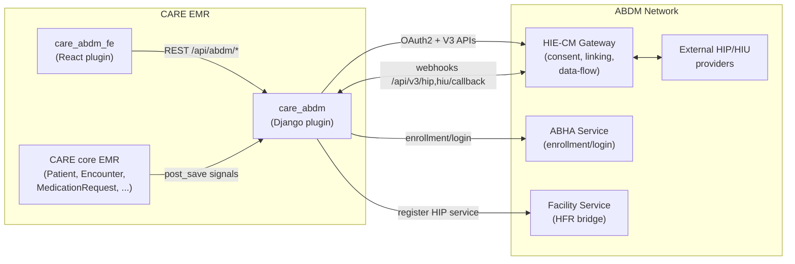
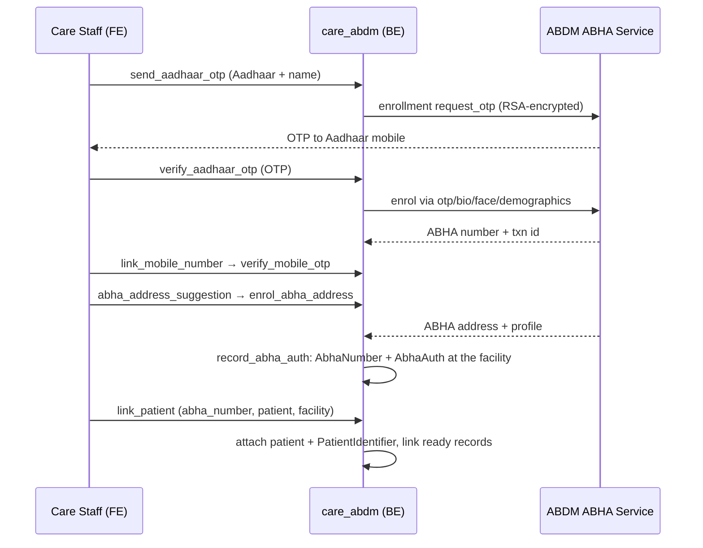
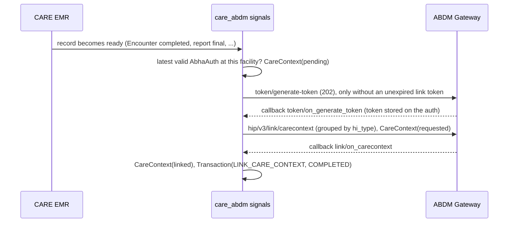
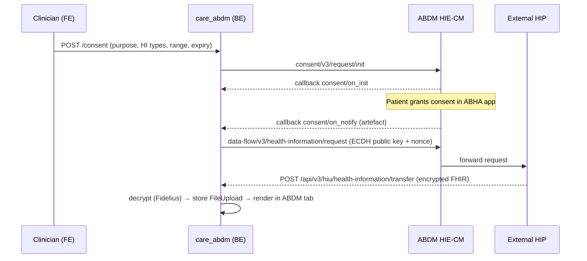

# CARE ABDM Integration — Complete Technical Documentation

> A deep-dive reference covering the ABDM domain, the backend plugin (`care_abdm`,
> Django) and the frontend plugin (`care_abdm_fe`, React/TypeScript), and the
> end-to-end flows that connect CARE to India's national digital health network.

---

## Table of Contents

1. [ABDM Background & Concepts](#1-abdm-background--concepts)
2. [High-Level Architecture](#2-high-level-architecture)
3. [Backend Plugin (`care_abdm`)](#3-backend-plugin-care_abdm)
   - [3.1 App Layout & Bootstrapping](#31-app-layout--bootstrapping)
   - [3.2 Configuration & Settings](#32-configuration--settings)
   - [3.3 Data Models](#33-data-models)
   - [3.4 URL Routing](#34-url-routing)
   - [3.5 API ViewSets](#35-api-viewsets)
   - [3.6 Service Layer (ABDM Gateway V3)](#36-service-layer-abdm-gateway-v3)
   - [3.7 Authentication](#37-authentication)
   - [3.8 Cryptography (Fidelius / ECDH)](#38-cryptography-fidelius--ecdh)
   - [3.9 FHIR Generation](#39-fhir-generation)
   - [3.10 Signals (Auto Care-Context Linking)](#310-signals-auto-care-context-linking)
   - [3.11 Background Tasks](#311-background-tasks)
   - [3.12 Scan & Share Tokens](#312-scan--share-tokens)
   - [3.13 Admin](#313-admin)
4. [Frontend Plugin (`care_abdm_fe`)](#4-frontend-plugin-care_abdm_fe)
   - [4.1 Plugin Registration](#41-plugin-registration)
   - [4.2 Pluggable Components](#42-pluggable-components)
   - [4.3 Feature Components](#43-feature-components)
   - [4.4 API Layer](#44-api-layer)
   - [4.5 Types](#45-types)
   - [4.6 Hooks & Utilities](#46-hooks--utilities)
5. [End-to-End Flows](#5-end-to-end-flows)
6. [Configuration Reference](#6-configuration-reference)
7. [Glossary](#7-glossary)
8. [Known Gaps](#8-known-gaps)
   - [8.1 Health Information Push Format](#81-health-information-push-format)

---

## 1. ABDM Background & Concepts

**ABDM (Ayushman Bharat Digital Mission)** is the Government of India's program to
build the digital backbone of the country's health ecosystem. It defines a set of
federated building blocks and registries that allow patient health records to be
created, discovered, and exchanged across providers with the patient's consent.

### Core building blocks

| Term | Expansion | What it is |
| --- | --- | --- |
| **ABHA Number** | Ayushman Bharat Health Account number | A 14-digit unique health ID for a citizen (displayed as `XX-XXXX-XXXX-XXXX`). The permanent identity anchor. |
| **ABHA Address** | (a.k.a. PHR address) | A human-readable handle like `username@abdm` / `username@sbx`. Used for consent, linking and login. One ABHA number can have several, and an address can exist without a number. |
| **HIP** | Health Information Provider | An entity that *produces/stores* records (e.g. a hospital running CARE). CARE acts as a HIP. |
| **HIU** | Health Information User | An entity that *requests/consumes* records to provide care. CARE also acts as a HIU. |
| **HIE-CM / CM** | Health Information Exchange & Consent Manager | The ABDM component that brokers consent between patients, HIPs and HIUs. Identified by a **CM ID** (e.g. `sbx`). |
| **HRP / Bridge** | Health Repository Provider / Bridge | The software bridge that registers a facility's HIP/HIU services with the gateway. |
| **HF ID** | Health Facility ID | The unique facility identifier issued by ABDM's Facility Registry (HFR). Required before a facility can act as a HIP. |
| **Care Context** | — | A pointer to a unit of clinical data (an encounter, a prescription, a report) registered against a patient's ABHA so it becomes discoverable/linkable. |
| **Consent Artefact** | — | The cryptographically-signed, granted permission that scopes *what* data, *for whom*, *for how long*, and at what *access mode*. |

### The ABDM gateways CARE talks to

- **ABDM Gateway / HIE-CM** (`ABDM_GATEWAY_URL`, default `https://dev.abdm.gov.in/api/hiecm`)
  — consent, linking, and data-flow orchestration (V3 APIs).
- **ABHA Service** (`ABDM_ABHA_URL`, default `https://abhasbx.abdm.gov.in/abha/api`)
  — ABHA enrollment, login, profile and card.
- **Facility Service / HFR Bridge** (`ABDM_FACILITY_URL`, default `https://facilitysbx.abdm.gov.in`)
  — registering a CARE facility as a HIP/HIU service.

> Defaults point at the **sandbox (SBX)** environment. Production deployments
> override the URLs, `ABDM_CLIENT_ID`/`ABDM_CLIENT_SECRET`, and `ABDM_CM_ID`.

### The two principal exchange patterns

1. **HIP flow (CARE produces data).** When clinical records are created in CARE,
   they are registered as *care contexts* against the patient's ABHA. When another
   provider (HIU) requests them with a valid consent, CARE encrypts the relevant
   FHIR bundles and pushes them to the requester.
2. **HIU flow (CARE consumes data).** A CARE clinician raises a *consent request*
   for a patient's external records. Once the patient grants consent, the
   corresponding HIPs transfer encrypted FHIR bundles to CARE, which decrypts and
   renders them.

### Scan & Share

A patient-facing onboarding shortcut: a facility prints a QR code at its
registration desk. The patient scans it with their ABHA app and shares a profile;
CARE receives a short-lived **token** (a queue token number) that front-desk staff
use to pull up the patient instantly without manual data entry.

---

## 2. High-Level Architecture



- The **frontend** is a pluggable library injected into CARE's UI at well-known
  extension points; it only talks to the backend plugin over `/api/abdm/*`.
- The **backend** is a Django app plugin that exposes model APIs, proxies/wraps the
  ABDM V3 gateway APIs, receives gateway webhooks, and reacts to EMR changes via
  signals.

---

## 3. Backend Plugin (`care_abdm`)

Repository: `care_abdm` · Django app package: `abdm/`

### 3.1 App Layout & Bootstrapping

```
abdm/
├── apps.py            # AppConfig; verbose_name "ABDM Integration"; imports signals on ready()
├── settings.py        # PluginSettings (env / PLUGIN_CONFIGS driven)
├── urls.py            # DRF router with optional-trailing-slash
├── authentication.py  # ABDMAuthentication (validates ABDM-signed JWTs on callbacks)
├── extensions.py      # the `abdm` encounter extension (opt-out of linking)
├── admin.py           # Django admin registrations
├── models/            # AbhaNumber, AbhaAuth, CareContext, Consent*, Transaction, HealthFacility, base enums
├── api/               # viewsets (model APIs) + api/v3 (gateway proxy & callbacks)
├── service/           # HTTP client + v3 services (gateway, health_id, facility), abha.py (identity & auth), linking.py
├── utils/             # crypto (fidelius, cipher), fhir/, token helpers
├── signals/           # auto care-context registration on EMR changes
├── tasks/             # Celery tasks (retry failed care contexts)
├── data/              # static data (e.g. state_districts.json)
└── migrations/
```

`apps.py` registers the app under the name **`abdm`** and, on `ready()`, imports
`abdm.extensions`, which registers the `abdm` encounter extension with CARE, and
`abdm.signals` so the EMR `post_save`/`pre_save` receivers are wired up.

See [abdm/apps.py](abdm/apps.py).

### 3.2 Configuration & Settings

`abdm/settings.py` defines a `PluginSettings` object that resolves each value in
priority order:

1. `django.conf.settings.PLUGIN_CONFIGS["abdm"]`
2. Environment variable of the same name
3. Hard-coded default

It **validates required settings at startup** and raises `ImproperlyConfigured` if
any are missing/falsy.

**Required settings**

```
ABDM_CLIENT_ID, ABDM_CLIENT_SECRET,
ABDM_GATEWAY_URL, ABDM_ABHA_URL, ABDM_FACILITY_URL,
ABDM_CM_ID, CURRENT_DOMAIN, BACKEND_DOMAIN
```

**Defaults (selected)**

| Setting | Default | Notes |
| --- | --- | --- |
| `ABDM_CLIENT_ID` | `SBX_001` | OAuth2 client/bridge id |
| `ABDM_CLIENT_SECRET` | `xxxx` | OAuth2 secret |
| `ABDM_GATEWAY_URL` | `https://dev.abdm.gov.in/api/hiecm` | HIE-CM gateway |
| `ABDM_ABHA_URL` | `https://abhasbx.abdm.gov.in/abha/api` | ABHA enrollment/login |
| `ABDM_FACILITY_URL` | `https://facilitysbx.abdm.gov.in` | HFR bridge |
| `ABDM_CM_ID` | `sbx` | Consent Manager id |
| `ABDM_USERNAME` | `abdm_user_internal` | system user for callbacks |
| `ABDM_HIP_NAME_PREFIX` / `_SUFFIX` | `""` | decorate HIP display name |
| `ABDM_REQUEST_TIMEOUT` | `30` | seconds |
| `ABDM_ABHA_NUMBER_IDENTIFIER_SYSTEM_SYSTEM` | `https://care.ohc.network/abha_number` | FHIR identifier system |
| `ABDM_SCAN_AND_SHARE_TOKEN_EXPIRY_TIME` | `1800` | 30 min |
| `ABDM_ALLOW_UNVERIFIED_ABHA_ACCOUNT` | `True` | allow linking unverified ABHA |
| `ABDM_DEEP_LINK_SMS_ENABLED` | `True` | ask ABDM to text a deep link to a patient whose records are ready and who has no ABHA auth at the facility |
| `CURRENT_DOMAIN` | `https://care.ohc.network` | frontend domain |
| `BACKEND_DOMAIN` | `https://careapi.ohc.network` | used in callback/push URLs |

A `setting_changed` receiver reloads cached settings when `PLUGIN_CONFIGS` changes
(useful in tests). See [abdm/settings.py](abdm/settings.py).

### 3.3 Data Models

Located in `abdm/models/`.

#### Enums — [abdm/models/base.py](abdm/models/base.py)

- **Status**: `REQUESTED`, `GRANTED`, `DENIED`, `EXPIRED`, `REVOKED` (consent lifecycle).
- **Purpose** (HL7 *PurposeOfUse*): `CAREMGT`, `BTG` (Break-The-Glass / emergency),
  `PUBHLTH`, `HPAYMT`, `DSRCH`, `PATRQT`.
- **HealthInformationType**: `Prescription`, `DiagnosticReport`, `OPConsultation`,
  `DischargeSummary`, `ImmunizationRecord`, `HealthDocumentRecord`, `WellnessRecord`,
  `Invoice`.
- **AccessMode**: `VIEW`, `STORE`, `QUERY`, `STREAM`.
- **FrequencyUnit**: `HOUR`, `DAY`, `WEEK`, `MONTH`, `YEAR` (throttles recurring pulls).

#### `AbhaNumber` — [abdm/models/abha_number.py](abdm/models/abha_number.py)

The patient's ABHA identity stored in CARE. It is instance-wide: one row per
person, whichever facility verified them.

- Identity: `abha_number` (unique, nullable: a person may have an ABHA address only).
- Link: `patient` (OneToOne → `emr.Patient`).
- Demographics: `name`, `first_name`, `middle_name`, `last_name`, `gender`,
  `date_of_birth`, `address`, `district`, `state`, `pincode`, `mobile`, `email`,
  `profile_photo`.
- ABDM OAuth tokens: `access_token`, `refresh_token`.
- `new` flag.
- Property `parsed_date_of_birth()` — tolerates missing month/day by defaulting to `01`.

It holds no ABHA address. Addresses live on `AbhaAuth`.

#### `AbhaAuth` — [abdm/models/abha_auth.py](abdm/models/abha_auth.py)

One row for each time an ABHA was authenticated at a health facility, with the
ABHA address that was presented. Everything a facility does with an ABHA (link
tokens, linking, consent requests) uses an auth made at that facility.

- `abha_number` (→ `AbhaNumber`), `health_facility` (→ `HealthFacility`),
  `abha_address` (trimmed, lower-cased), `method` (`scan_and_share`,
  `staff_verification`, `abha_creation`, `legacy`), `performed_by`.
- `link_token`, `link_token_expires_at` — the link token ABDM issued to this
  facility for this address.
- `invalidated_at`, `invalidation_reason` (`address_moved`, `link_token_refused`).

A row is never overwritten: only the link token and the invalidation change, and
`save()` refuses anything else. The **latest valid auth** (newest, not
invalidated) of a record at a facility is the one in use there.

#### `CareContext` — [abdm/models/care_context.py](abdm/models/care_context.py)

The ledger of care contexts linked, or being linked, at a facility.

- `health_facility`, `patient`, `abha_address`, `abha_auth` (null for links the
  patient made from a PHR app), `reference` (`v2::<model>::<id>`), `hi_type`.
- `status`: `pending` → `requested` → `linked`, or `failed`.
- `via`: `hip_initiated` or `user_initiated`.
- `request_id` — the `REQUEST-ID` of the link call, matched by the callback.
- `legacy` — backfilled from `Transaction` history; its address is the one
  stored at the time of the upgrade, not necessarily the one linked to.
- Unique on (`health_facility`, `abha_address`, `reference`).

#### Consent models — [abdm/models/consent.py](abdm/models/consent.py)

- **`Consent` (abstract base)**: `consent_id` (UUID from gateway), `encounter`
  (→ `emr.Encounter`), `care_contexts` (JSON, schema
  validated), `status`, `purpose`, `hi_types`, `hip`, `hiu`, `requester`
  (→ `users.User`), `access_mode`, `from_time`/`to_time` (default: 30 days ago → now),
  `expiry` (default +30 days), and frequency fields (`frequency_unit`,
  `frequency_value`, `frequency_repeats`).
- **`ConsentRequest`**: the raised request; exposes a `request_id` property.
  `abha_auth` (→ `AbhaAuth`) is the auth it was raised from, which gives the ABHA
  address and the requesting facility.
- **`ConsentArtefact`**: the granted permission. `health_facility`,
  `abha_address` and `patient` scope it: copied from the request's auth when CARE
  is the HIU, taken from the notification when CARE is the HIP. Adds the **ECDH
  key material** used for encrypting/decrypting transferred data:
  `key_material_algorithm` (`ECDH`), `key_material_curve` (`Curve25519`),
  `key_material_public_key`, `key_material_private_key`, `key_material_nonce`,
  `signature`, plus `cm` (Consent Manager id). Its `save()` override **auto-generates
  a keypair on first save** and **archives associated `FileUpload`s** when the consent
  is revoked/expired.

#### `Transaction` — [abdm/models/transaction.py](abdm/models/transaction.py)

A unified audit log of every ABDM interaction.

- **TransactionType**: `CREATE_OR_LINK_ABHA_NUMBER`, `CREATE_ABHA_ADDRESS`,
  `SCAN_AND_SHARE`, `LINK_CARE_CONTEXT`, `EXCHANGE_DATA`, `ACCESS_DATA`.
- **TransactionStatus**: `INITIATED`, `COMPLETED`, `FAILED`, `CANCELLED`.
- Fields: `reference_id` (request/transaction id), `type`, `status`, `meta_data`
  (JSON payload), `created_by` (→ `users.User`).

#### `HealthFacility` — [abdm/models/health_facility.py](abdm/models/health_facility.py)

Binds a CARE facility to an ABDM HIP.

- `hf_id` (unique ABDM facility id), `registered` (bool), `facility` (OneToOne →
  `facility.Facility`).
- `save()` override: when `hf_id` changes, it updates the pending/failed
  `LINK_CARE_CONTEXT` transactions so they re-link against the new id.
- `hf_id` cannot change more than 48 hours after the row was created: `save()`
  raises a `ValidationError`, which the API returns as a `400`. ABDM holds links,
  link tokens and consents against the id.

#### Encounter extension `abdm` — [abdm/extensions.py](abdm/extensions.py)

Not a model of the plugin: a `PlugExtension` registered for CARE's encounter
resource, stored under `Encounter.extensions["abdm"]`. It holds the patient's
choice to keep a visit out of ABDM.

- Written as `{"link_records": false}` when the encounter is created. The plugin
  then stamps `recorded_by` (the `external_id` of the user who created the
  encounter) and `recorded_at` into the stored value.
- It can only be set at creation. A later change to the key is ignored and the
  stored value is kept, because a linked care context cannot be unlinked. CARE's
  validator cannot tell an update from a create, so this is kept by a
  `pre_save` receiver on `Encounter`.
- An encounter with `link_records` false is never linked, is left out of
  discovery, never causes a deep-link SMS, and is refused if it is requested.
- A care context that spans encounters follows from that. A prescription
  (`v2::prescription::<date>`) is linked when at least one of its medication
  requests is of an encounter that is not opted out, and the requests of
  opted-out encounters are left out when it is shared. An invoice is one
  document, so a charge of an opted-out encounter keeps the whole invoice out.

### 3.4 URL Routing

`abdm/urls.py` uses an `OptionalSlashRouter` (trailing slash optional). All routes
are mounted under the plugin prefix (`/api/abdm/`):

**Model routes**

| Route | ViewSet |
| --- | --- |
| `consent` | `ConsentViewSet` |
| `health_information` | `HealthInformationViewSet` |
| `abha_number` | `AbhaNumberViewSet` |
| `health_facility` | `HealthFacilityViewSet` |

**Gateway proxy routes**

| Route | ViewSet |
| --- | --- |
| `v3/health_id` | `HealthIdViewSet` (ABHA enrollment/login/link) |
| `v3/hip` | `HIPViewSet` |
| `v3/hiu` | `HIUViewSet` |
| `v3/utility` | `UtilityViewSet` (states/districts) |

**Callback routes** (consumed by ABDM, secured with `ABDMAuthentication`)

| Route | ViewSet |
| --- | --- |
| `api/v3` (`/api/v3/hip/...`) | `HIPCallbackViewSet` |
| `api/v3` (`/api/v3/hiu/...`) | `HIUCallbackViewSet` |

See [abdm/urls.py](abdm/urls.py).

### 3.5 API ViewSets

#### `AbhaNumberViewSet` — [abdm/api/viewsets/abha_number.py](abdm/api/viewsets/abha_number.py)
- `POST /abha_number` — scan and pull: record an ABHA read at a facility
  (`facility` required) and the auth for it.
- `GET /abha_number/{id}?facility=` — retrieve by patient id, ABHA number or ABHA
  address. The response carries `abha_address` and `auth` as seen from that
  facility: the latest valid auth there, with the address falling back to the one
  last used anywhere.

#### `ConsentViewSet` — [abdm/api/viewsets/consent.py](abdm/api/viewsets/consent.py)
- `POST /consent` — create a consent request for an `encounter` via
  `GatewayService.consent__request__init()`, using the patient's latest valid
  auth at the encounter's facility (400 when there is none).
- `GET /consent` — list consents filtered by the user's facilities and patient.
- Rate-limited (with CAPTCHA fallback).

#### `HealthFacilityViewSet` — [abdm/api/viewsets/health_facility.py](abdm/api/viewsets/health_facility.py)
- `POST /health_facility` — create; async task calls `FacilityService.add_update_service()`.
- `PUT /health_facility/{id}` — update `hf_id`; re-registers if it changed.
- `POST /health_facility/{id}/register_service` — manual registration trigger.

#### `HealthInformationViewSet` — [abdm/api/viewsets/health_information.py](abdm/api/viewsets/health_information.py)
- `GET /health_information/{id}` — return the decrypted FHIR bundle stored against a
  consent artefact's `FileUpload`.

#### `HealthIdViewSet` — [abdm/api/v3/viewsets/health_id.py](abdm/api/v3/viewsets/health_id.py)

ABHA **creation** (proxied to the ABHA service):
`abha_create/verify_aadhaar_bio`, `auth_init_via_face`, `capture_pid_via_face`,
`verify_aadhaar_otp`, `verify_aadhaar_demographics`, `link_mobile_number`,
`enrol_abha_address`.

ABHA **login**: `abha_login/send_otp`, `verify_otp`, `verify_user`,
`check_auth_methods`.

Every endpoint that returns a verified ABHA takes `facility` and records an
`AbhaAuth` there through `record_abha_auth`.

**Linking**: `link_patient` — attaches an ABHA record to a CARE patient, given a
valid auth for it at `facility`, and creates a `PatientIdentifier`. Repeating it
for the same record is how a patient verifies again; a different record is
refused. It then links the patient's ready records at that facility.

#### `HIPViewSet` & `HIPCallbackViewSet` — [abdm/api/v3/viewsets/hip.py](abdm/api/v3/viewsets/hip.py)

User-facing HIP ops:
- `POST v3/hip/link_care_context` — returns `202` (auto-linked, no manual step).
- `GET v3/hip/patient/fetch-by-token?token=&facility_id=` — resolve a scan-and-share token.

ABDM→CARE webhooks (`HIPCallbackViewSet`, `ABDMAuthentication`):
`token/on_generate_token`, `link/on_carecontext`, `links/context/on-notify`,
`patients/sms/on-notify`, `patient/care_context/discover`,
`link/care_context/init`, `link/care_context/confirm`, `consent/request/notify`,
`health_information/request`, `patient/share`.

The two `on-notify` callbacks answer `link/context/notify` and the deep-link SMS.
ABDM's pages for their bodies are not confirmed against the sandbox, so nothing
in them is required, and each body is logged on arrival at debug level with the
fields that may hold personal data redacted.

#### `HIUViewSet` & `HIUCallbackViewSet` — [abdm/api/v3/viewsets/hiu.py](abdm/api/v3/viewsets/hiu.py)

User-facing HIU ops:
- `verify_identity` → `GatewayService.identity__authentication()`.
- `create_consent_request` (delegates to `ConsentViewSet`).
- `consent_request_status`, `fetch_consent_artefact`.

ABDM→CARE webhooks (`HIUCallbackViewSet`, `ABDMAuthentication`):
`consent/on_init`, `consent/on_status`, `consent/on_fetch`, `consent/on_notify`,
`health_information/on_request`, `health_information/transfer` (receives encrypted
data), `patient_share/on_share`.

#### `UtilityViewSet` — [abdm/api/v3/viewsets/utility.py](abdm/api/v3/viewsets/utility.py)
- `GET v3/utility/states` and `.../states/{code}/districts` (from `data/state_districts.json`).

### 3.6 Service Layer (ABDM Gateway V3)

#### HTTP client — [abdm/service/request.py](abdm/service/request.py)

The `Request` class is the single outbound HTTP wrapper:
- **OAuth2 session management** — fetches a token from
  `ABDM_GATEWAY_URL + /gateway/v3/sessions`, caches it with expiry, retries on the
  `900901` "invalid token" error.
- `get()` / `post()` with auto-retry.
- Standard headers on every call: `Content-Type`, `REQUEST-ID` (UUID),
  `TIMESTAMP` (ISO-8601 UTC), `X-CM-ID`. An optional end-user JWT is forwarded as
  `X-Token`.

#### Helpers — [abdm/service/helper.py](abdm/service/helper.py)

- Exceptions: `ABDMAPIException`, `ABDMInternalException` (both HTTP 400).
- `timestamp()`, `uuid()`, `cm_id()`.
- `encrypt_message()` — RSA-OAEP encryption using the ABDM public certificate.
- `validate_and_format_date()`.
- `hf_id_from_encounter()` — resolve the HIP id.
- **Care-context generators** — turn EMR rows into care-context dicts
  (`reference`, `display`, `hi_type`). The reference format is
  `v2::<model>::<id/param>` and is parsed back by
  `care_context_dict_from_reference_id()`:
  - `create_encounter_care_context()`
  - `create_medication_request_care_context()`
  - `create_file_upload_care_context()`
  - `create_questionnaire_response_care_context()`
  - `create_diagnostic_report_care_context()`
  - `create_invoice_care_context()`
  - `create_immunization_care_context()`
  - `ready_care_contexts_for_encounter(encounter)` — the care contexts of an
    encounter whose records are ready to link.
  - `resolve_care_context(reference, patient, facility)` — the record behind a
    reference, when it is that patient's record at that facility, with whether
    the opt-out of its encounters keeps it out of ABDM.
  - `encounter_hi_type(encounter)` — discharge summary for the admission classes
    (`imp`, `emer`, `obsenc`), OP consultation for the others. Used both when
    linking and when sharing.

#### ABHA identity and auth — [abdm/service/abha.py](abdm/service/abha.py)

- `record_abha_auth(...)` — the only writer of `AbhaNumber` and creator of
  `AbhaAuth`. Under a lock on the number and the address it finds the record by
  ABHA number, then by the address on a valid auth anywhere; the number wins when
  the two disagree, and an address that moved to another number invalidates the
  auths that held it (`address_moved`).
- `latest_valid_auth(abha_number, health_facility)`,
  `abha_number_for_address(address)`, `patient_for_abha(abha_number, abha_address)`.

#### Linking — [abdm/service/linking.py](abdm/service/linking.py)

- `ready_care_contexts(patient, health_facility)` — full back-scan of a patient's
  records at a facility that are ready to link.
- `link_care_contexts(patient, health_facility, care_contexts=None, user=None)` —
  the one linking routine. Leaves out opted-out encounters
  (`is_linking_opted_out`, which reads the `abdm` encounter extension) and
  references already in the ledger, creates `pending` rows under the latest valid
  auth, and sends them. Without an auth at the facility it links nothing and
  calls `notify_patient_without_auth`.
- `notify_patient_without_auth(patient, health_facility)` — asks ABDM to text the
  patient a deep link (`link/patient/links/sms/notify2`). At most once per
  patient and facility in a calendar day (a cache key taken before the call and
  kept whatever comes of it), only for a patient with an Indian mobile number,
  and only when `ABDM_DEEP_LINK_SMS_ENABLED` is on. A failure is logged and does
  not fail the linking routine.
- `send_pending_care_contexts(auth)` — sends pending rows in batches of 20 when
  the auth has an unexpired link token, otherwise requests a token (at most once
  in 30 minutes per facility and address).
- `receive_link_token(...)`, `complete_link_request(...)` — the two callbacks.
- **Already linked is done, not failed.** `ABDM-1056` "already linked" on the
  callback, and "Duplicate HIP link request" on the link call itself, mark a
  request of one care context `linked`. A request of several is sent again one
  care context at a time, since ABDM does not say which of them it holds; a
  request of one is never split, so this cannot go round. A duplicate answer to
  a request that is being sent again under the same id leaves it `requested`,
  to wait for the callback of the first attempt.
- `notify_care_context_updated(patient, health_facility, reference)` and
  `sync_linked_record_type(encounter)` — call `link/context/notify` for care
  contexts that are `linked` in the ledger, with the address and facility of the
  ledger row: when a prescription gains a medication request, and when an
  encounter's class makes it another record type, in which case
  `CareContext.hi_type` is updated too.
- `record_user_initiated_links(...)` — links a patient made from a PHR app.

#### `GatewayService` — [abdm/service/v3/gateway.py](abdm/service/v3/gateway.py)

The largest service (~2k LOC). Key method groups:

- **Token**: `token__generate_token()` — requests a link token for an auth (async
  `202`; the token arrives on the callback and is stored on the auth).
- **Care-context linking**: `link__carecontext()` — groups care contexts by
  `hi_type` and POSTs to `/hip/v3/link/carecontext` with the `X-LINK-TOKEN`. The
  ledger and the `LINK_CARE_CONTEXT` transaction are kept by `service/linking.py`.
  User-initiated variants handle discover/init/confirm with OTP.
  `link__context__notify()` POSTs to `/hip/v3/link/context/notify` and
  `link__patient__links__sms__notify2()` to
  `/hip/v3/link/patient/links/sms/notify2`; both answer on a callback.
- **Consent**: `consent__request__init()`, `consent__request__status()`,
  `consent__fetch()`, plus the HIP/HIU `on_notify` handlers.
- **Data flow** (the heart of HIE):
  - `data_flow__health_information__request()` — sets up the ECDH keypair + nonce and
    declares the push URL
    `BACKEND_DOMAIN/api/abdm/api/v3/hiu/health-information/transfer`.
  - **`data_flow__health_information__transfer()`** — for each consented care
    context, checks that it is a record of the artefact's patient at the
    artefact's facility (and, where the ledger has a link for it, linked to the
    artefact's address), resolves the EMR row, builds the matching FHIR record via `Fhir()`,
    encrypts it (ECDH + AES-256-GCM), and POSTs to the requester's URL; records an
    `EXCHANGE_DATA` transaction.
  - `..._hip__on_request()`, `..._notify()`.
- **Identity**: `identity__authentication()` — demographic verification for HIU
  consent.
- **Scan & share**: `patient_share__on_share()`.

The mapping used in `data_flow__health_information__transfer()`:

| `reference` model | EMR source | FHIR builder |
| --- | --- | --- |
| `prescription` | `MedicationRequest` | `create_prescription_record()` |
| `encounter` | `Encounter` | `create_discharge_summary_record()` for an admission class, else `create_op_consult_record()`, by the encounter's current class and only if the consent allows that type |
| `file_upload` | `FileUpload` | `create_health_document_record()` |
| `questionnaire_response` | `QuestionnaireResponse` | `create_wellness_record()` |
| `diagnostic_report` | `DiagnosticReport` | `create_diagnostic_report_record()` |
| `invoice` | `Invoice` | `create_invoice_record()` |
| `immunization` | `Immunization` | `create_immunization_record()` |

#### `HealthIdService` — [abdm/service/v3/health_id.py](abdm/service/v3/health_id.py)

Wraps the ABHA service (`ABDM_ABHA_URL/v3`). Aadhaar enrollment (`via_bio`,
`via_demographics`, `via_otp`, `request_otp`), face enrollment (`auth_init__via_face`,
`capturePID__via_face`), `enrol__abha_address`, and login
(`profile__login__request_otp/verify_otp/verify_user`). All sensitive payloads are
RSA-encrypted using the certificate from `/v3/profile/public/certificate`.

#### `FacilityService` — [abdm/service/v3/facility.py](abdm/service/v3/facility.py)

`add_update_service()` registers/updates the facility as a HIP via
`ABDM_FACILITY_URL/v1/bridges/MutipleHRPAddUpdateServices`. The payload carries the
`facilityId` (`hf_id`), the decorated `facilityName` (with prefix/suffix), and an
`HRP` block bound to `ABDM_CLIENT_ID` with `type=HIP`. On success the returned
`hf_id` is persisted on the `HealthFacility`.

### 3.7 Authentication

[abdm/authentication.py](abdm/authentication.py) — `ABDMAuthentication` extends DRF's
`JWTAuthentication`:
- `authenticate()` validates an ABDM-signed JWT on inbound **callback** endpoints.
- `open_id_authenticate()` fetches the gateway's public key from its JWKS endpoint
  and verifies the `RS256` signature.
- `get_user()` resolves/creates the internal system user (`ABDM_USERNAME`,
  default `abdm_user_internal`) so callbacks act under a known principal.

### 3.8 Cryptography (Fidelius / ECDH)

ABDM mandates **end-to-end encryption** of transferred health data using an ECDH key
exchange on **Curve25519**, compatible with the Java *Fidelius/BouncyCastle*
reference.

[abdm/utils/fidelius.py](abdm/utils/fidelius.py):
- `KeyMaterial.generate()` — produces `{private_key, public_key (raw + X509), nonce}`;
  the X509 form includes the BouncyCastle prefix expected by Java peers; the nonce is
  32 random bytes (base64).
- **Encrypt**: XOR the sender & receiver nonces → split into a 12-byte IV + 20-byte
  salt → derive an AES key via HKDF-SHA256 over the ECDH shared secret →
  AES-256-GCM encrypt → base64 of ciphertext+tag.
- `DecryptionRequest` reverses the process with the private key.

[abdm/utils/cipher.py](abdm/utils/cipher.py) — a `Cipher` convenience wrapper around
Fidelius for `ConsentArtefact` key material: `generate_key_pair()`, `encrypt()` →
`{publicKey, data, nonce}`, and `decrypt()`.

### 3.9 FHIR Generation

[abdm/utils/fhir/fhir.py](abdm/utils/fhir/fhir.py) — the `Fhir` class composes
**FHIR R4B** document `Bundle`s per NRCES guidelines. Each builder emits a
`Composition` plus all referenced resources (`Patient`, `Practitioner`,
`Organization`, `Condition`, `Medication`, `Observation`, …) and security metadata
(confidentiality = *Very Restricted*), keyed by the care-context id:

`create_prescription_record`, `create_op_consult_record`,
`create_discharge_summary_record`, `create_health_document_record`,
`create_wellness_record`, `create_diagnostic_report_record`, `create_invoice_record`,
`create_immunization_record`.

An encounter whose status is `entered_in_error` is still shared when it is
requested, since a link cannot be undone. Its OP consultation or discharge
summary `Composition` carries the status `entered-in-error`, and its sections
are left as they are.

### 3.10 Signals (Auto Care-Context Linking)

[abdm/signals/register_care_contexts.py](abdm/signals/register_care_contexts.py) — the
plugin links a care context when its record becomes ready to share, so records
become discoverable without manual steps:

| Signal | Model | Ready when |
| --- | --- | --- |
| `pre_save` + `post_save` | `MedicationRequest` | first request of the day that is not a draft |
| `pre_save` + `post_save` | `Encounter` | status changes to `completed` or `discharged`, or the encounter is created in one of them |
| `pre_save` | `FileUpload` | upload completes (`upload_completed → True`) |
| `post_save` | `QuestionnaireResponse` | questionnaire filled |
| `pre_save` | `DiagnosticReport` | status changes to `final` |
| `pre_save` | `Invoice` | non-draft invoice issued |
| `pre_save` | `Immunization` | dose recorded as `completed` / `not_done`, or a draft finalised |

Each receiver only checks that the encounter's facility is a **registered HIP**,
then queues `abdm.link_care_context` inside `transaction.on_commit()`. Whether the
record is linked, and to which ABHA address, is decided by
`link_care_contexts`. Failures never crash the EMR write path.

The same receivers report changes to care contexts that are already linked: a
medication request added on a day whose prescription is `linked` queues
`abdm.notify_care_context_update` (one notification a minute at most per
prescription), and an encounter whose class moves between the admission classes
and the others queues `abdm.sync_encounter_record_type`. The `Encounter`
`pre_save` receiver also stamps the `abdm` extension on creation and keeps it
unchanged afterwards.

### 3.11 Background Tasks

- [abdm/tasks/link_care_context.py](abdm/tasks/link_care_context.py):
  `abdm.link_care_context` links one care context;
  `abdm.link_patient_care_contexts` links everything ready for a patient at a
  facility, and runs after `link_patient` and after a scan and share by a
  patient CARE already knows. `abdm.notify_care_context_update` and
  `abdm.sync_encounter_record_type` call `link/context/notify` for linked care
  contexts that changed.
- [abdm/tasks/retry_failed_care_contexts.py](abdm/tasks/retry_failed_care_contexts.py):
  `retry_failed_care_contexts()` (`@shared_task`, Celery Beat) moves `failed`
  care contexts, and `requested` ones unanswered for a day, back to `pending`,
  then dispatches `send_pending_care_contexts_batch` (`queue="care_context_queue"`)
  for the auths that have care contexts waiting.

### 3.12 Scan & Share Tokens

`abdm/utils/token.py` — `get_or_create_scan_and_share_token(patient, facility)` builds
a `TokenQueue` + `Category` ("ABDM" / "Scan and Share") and issues a token that
expires after `ABDM_SCAN_AND_SHARE_TOKEN_EXPIRY_TIME` (default 30 min).
`get_scan_and_share_token_by_token_number()` resolves it back to a patient at the
front desk.

### 3.13 Admin

[abdm/admin.py](abdm/admin.py) registers `AbhaNumber` (searchable by number/ABHA
address/name/mobile), `AbhaAuth` (read only), `CareContext`, `ConsentArtefact`,
`ConsentRequest`, `Transaction`, and `HealthFacility`. A non-production-only `delete_abdm_records` action cascade-deletes
ABHA + consent data.

---

## 4. Frontend Plugin (`care_abdm_fe`)

Repository: `care_abdm_fe` · Source: `src/`

A Vite-built React 19 library that plugs into CARE's UI. It only communicates with
the backend over `/api/abdm/*`, using the host app's auth token and API base URL.

Key dependencies: `@tanstack/react-query` (server state), `react-hook-form` + `zod`
(forms/validation), `@radix-ui/*` + shadcn-style UI, `qrcode.react` (QR),
`hi-profiles` (FHIR rendering), `raviger` (routing), `react-i18next` (i18n),
`sonner` (toasts).

### 4.1 Plugin Registration

- [src/index.ts](src/index.ts) — re-exports `manifest` and `routes` to CARE's plugin
  loader.
- [src/manifest.ts](src/manifest.ts) — plugin id **`care_abdm`**. Declares the
  pluggable components injected into the host, and an `abdm` **encounter tab**.
- [src/routes.tsx](src/routes.tsx) — registers the standalone route
  `/abdm/health-information/:id` → `HealthInformation` page.
- [src/config.ts](src/config.ts) — currently empty (no static config).
- Runtime context: `window.__CORE_ENV__.apiUrl` (API base) and
  `__CARE_PLUGIN_RUNTIME__` meta (`faceAuthUrl`, `scanAndShareUrl`,
  `enforceAbhaNumberLinking`, `enableScanPayMarkPaid`, `enableScanPayCancelOrder`). Auth token read from `localStorage.care_access_token`.

### 4.2 Pluggable Components

`src/components/pluggables/` — injected at named CARE extension points:

| Component | Injection point | Purpose |
| --- | --- | --- |
| [PatientHomeActions.tsx](src/components/pluggables/PatientHomeActions.tsx) | `PatientHomeActions` | Button to create/link ABHA when patient has none. |
| [PatientDetailsTabDemographyGeneralInfo.tsx](src/components/pluggables/PatientDetailsTabDemographyGeneralInfo.tsx) | demography tab | ABHA card display + download (PNG/PDF). |
| [EncounterActions.tsx](src/components/pluggables/EncounterActions.tsx) | `EncounterActions` | "Fetch Health Records" → consent request. |
| [FacilityHomeActions.tsx](src/components/pluggables/FacilityHomeActions.tsx) | `FacilityHomeActions` | Configure HF ID + Scan-and-Share QR. |
| [PatientRegistrationForm.tsx](src/components/pluggables/PatientRegistrationForm.tsx) | registration form | Link ABHA and auto-fill demographics. |
| [PatientSearchActions.tsx](src/components/pluggables/PatientSearchActions.tsx) | patient search | Find patient by scan-and-share token. |

### 4.3 Feature Components

- **ABHA linking** — [LinkAbhaNumber/index.tsx](src/components/LinkAbhaNumber/index.tsx)
  wraps the flow in a drawer (`enforceLinking`, `backUrl`, `facilityId`, `onSuccess`).
  [LinkAbhaForm.tsx](src/components/LinkAbhaNumber/LinkAbhaForm.tsx) drives a
  multi-step flow via the `useMultiStepForm` hook:
  - **Create (Aadhaar)**: enter Aadhaar + name + disclaimers → send OTP → verify OTP
    → demographic verification (face / fingerprint via local RD service / manual
    demographics) → link mobile → verify mobile → ABHA-address suggestion → choose
    address → show profile.
  - **Link existing**: enter ABHA/address/mobile → check auth methods → send OTP →
    verify OTP → choose account → verify user → show profile.
  - [ShowAbhaProfile.tsx](src/components/LinkAbhaNumber/ShowAbhaProfile.tsx) renders
    the resulting ABHA card with download options.
- **Consent** — [CreateConsentRequestForm.tsx](src/components/CreateConsentRequestForm.tsx):
  purpose, date range, HI-types (multi-select), expiry; Zod-validated; POSTs to
  `/api/abdm/consent/`.
- **Facility** — [ConfigureHealthFacilityForm.tsx](src/components/ConfigureHealthFacilityForm.tsx)
  (enter/update HF ID, show registration status) and
  [GenerateScanAndShareQR.tsx](src/components/GenerateScanAndShareQR.tsx) (per-counter
  QR pointing at `scanAndShareUrl?hf=<HF_ID>&counter=<n>`, downloadable as SVG).
- **Token search** — [TokenSearchDialog.tsx](src/components/TokenSearchDialog.tsx):
  debounced 6-digit token lookup → patient card.
- **Encounter tab** — [encounter-tabs/Abdm.tsx](src/components/encounter-tabs/Abdm.tsx):
  lists consent requests + granted artefacts; refresh to poll status; click an
  artefact to view records.
- **Health records page** — [pages/HealthInformation.tsx](src/components/pages/HealthInformation.tsx):
  fetches and renders FHIR bundles with `hi-profiles`; handles loading, archived,
  and error states.
- **UI primitives** — `src/components/ui/` (shadcn-style: Button, Dialog, Drawer,
  Form, InputOTP, MultiSelect, Calendar, etc.).

### 4.4 API Layer

`src/apis/` — typed clients over the backend:

- [request.ts](src/apis/request.ts) — generic `request<T>()`; attaches the Bearer
  token, uses `window.__CORE_ENV__.apiUrl`, custom `APIError`, handles JSON +
  `image/png`.
- [index.ts](src/apis/index.ts) — grouped clients:
  - `consent` — `list`, `create`, `get`, `checkStatus` (→ `/v3/hiu/consent_request_status/`).
  - `healthInformation` — `get(artefactId)`.
  - `healthFacility` — `list`, `create`, `get`, `update`, `partialUpdate`,
    `registerAsService`.
  - `abhaNumber` — `get`, `create`.
  - `healthId` — ABHA create (Aadhaar OTP/bio/face/demographics), mobile linking,
    address suggestion/enrol, `linkAbhaNumberAndPatient`, login
    (`check_auth_methods`/`send_otp`/`verify_otp`/`verify_user`), `getAbhaCard`.
  - `utility` — `states`, `districts`.
  - `hip` — `getPatientByToken`.
  - `rdService` — `capture()` against the local biometric device at
    `https://127.0.0.1:11100/rd/capture`.
  - `user`, `govtOrganization` — host-app helpers for current user and geo lookup.

### 4.5 Types

`src/types/` mirrors the backend: `abhaNumber.ts` (`AbhaNumber`,
`AbhaLoginAccount`), `consent.ts` (purpose/status/HI-type/access-mode/frequency
unions + `Consent`/`ConsentRequest`/`ConsentArtefact`), `healthFacility.ts`,
`healthInformation.ts`, `meta.ts` (`MetaConfig`, `WithMeta<T>`), plus thin wrappers
for patient/facility/encounter/user/govtOrganization.

### 4.6 Hooks & Utilities

- [hooks/useDebouncedState.ts](src/hooks/useDebouncedState.ts) — debounce for token
  search.
- [hooks/useMessageListener.ts](src/hooks/useMessageListener.ts) — service-worker
  messages.
- [LinkAbhaNumber/useMultiStepForm.tsx](src/components/LinkAbhaNumber/useMultiStepForm.tsx)
  — step state machine with a shared `memory` object and `goTo()`.
- `lib/` — `utils.ts` (`cn`, toast helpers), `constants.ts`
  (`MAX_OTP_RESEND_COUNT=3`, `SUPPORTED_AUTH_METHODS=["AADHAAR_OTP","MOBILE_OTP"]`,
  `I18NNAMESPACE="care_abdm_fe"`), `dayjs.ts` (configured plugins).

---

## 5. End-to-End Flows

### 5.1 ABHA creation (Aadhaar) and patient linking



### 5.2 Automatic care-context linking (CARE as HIP)



### 5.3 Consent + health-information exchange (CARE as HIU)



When CARE is the HIP being asked (5.2 inverse), the
`data_flow__health_information__transfer()` path builds FHIR bundles from the EMR,
encrypts them with ECDH+AES-256-GCM, and pushes them to the requester.

### 5.4 Scan & Share

```
Facility configures HF ID → generates per-counter QR (scanAndShareUrl?hf=&counter=)
   → patient scans with ABHA app → ABDM posts share → BE issues queue token
   → front desk uses TokenSearchDialog (6-digit token) → patient resolved instantly.
```

---

## 6. Configuration Reference

### Backend `PLUGIN_CONFIGS["abdm"]` / environment

| Key | Required | Default | Description |
| --- | --- | --- | --- |
| `ABDM_CLIENT_ID` | ✅ | `SBX_001` | OAuth2/bridge client id |
| `ABDM_CLIENT_SECRET` | ✅ | `xxxx` | OAuth2 secret |
| `ABDM_GATEWAY_URL` | ✅ | `https://dev.abdm.gov.in/api/hiecm` | HIE-CM gateway |
| `ABDM_ABHA_URL` | ✅ | `https://abhasbx.abdm.gov.in/abha/api` | ABHA service |
| `ABDM_FACILITY_URL` | ✅ | `https://facilitysbx.abdm.gov.in` | HFR bridge |
| `ABDM_CM_ID` | ✅ | `sbx` | Consent Manager id |
| `CURRENT_DOMAIN` | ✅ | `https://care.ohc.network` | frontend domain |
| `BACKEND_DOMAIN` | ✅ | `https://careapi.ohc.network` | callback/push base |
| `ABDM_AUTH_URL` | — | `""` | optional auth url |
| `ABDM_USERNAME` | — | `abdm_user_internal` | callback system user |
| `ABDM_HIP_NAME_PREFIX` / `_SUFFIX` | — | `""` | HIP display name decoration |
| `ABDM_REQUEST_TIMEOUT` | — | `30` | request timeout (s) |
| `ABDM_SCAN_AND_SHARE_TOKEN_EXPIRY_TIME` | — | `1800` | token TTL (s) |
| `ABDM_ALLOW_UNVERIFIED_ABHA_ACCOUNT` | — | `True` | allow unverified ABHA linking |
| `ABDM_DEEP_LINK_SMS_ENABLED` | — | `True` | Ask ABDM to text a deep link to a patient whose records are ready to link and who has no ABHA auth at the facility. At most one text per patient and facility in a day; only for an Indian mobile number; never for an opted-out encounter |
| `ABDM_SCAN_AND_PAY_POLLING_ENABLED` | — | `False` | Celery status polling for scan-and-pay orders. Off unless set in the environment |
| `ABDM_SCAN_AND_PAY_POLLING_INTERVAL` | — | `10` | Polling interval in seconds, used only when polling is enabled |
| `ABDM_ABHA_NUMBER_IDENTIFIER_SYSTEM_SYSTEM` | — | `https://care.ohc.network/abha_number` | FHIR identifier system |

### Frontend runtime meta (`__CARE_PLUGIN_RUNTIME__` / `MetaConfig`)

| Key | Description |
| --- | --- |
| `enforceAbhaNumberLinking` | Force ABHA linking before proceeding |
| `scanAndShareUrl` | Base URL embedded in Scan-and-Share QR |
| `faceAuthUrl` | Face-auth helper URL for ABHA creation |
| `enableScanPayMarkPaid` | When `true`, show Mark as paid on the Scan & Pay page and the invoice menu. Hidden when omitted or `false`. |
| `enableScanPayCancelOrder` | When `true`, show Cancel order on the Scan & Pay page and the invoice menu. Hidden when omitted or `false`. |

---

## 7. Glossary

- **ABHA Number** — 14-digit permanent health id.
- **ABHA Address** — `name@cm` handle for consent, linking and login.
- **ABHA Auth** — one authentication of an ABHA at a health facility, with the
  address presented; what the facility uses to link records and request consent.
- **HIP / HIU** — provider of / user of health information. CARE is both.
- **HIE-CM / CM** — consent broker; `ABDM_CM_ID` (e.g. `sbx`).
- **HF ID** — ABDM facility id; prerequisite for HIP operation.
- **Care Context** — discoverable pointer to a clinical record (`v2::model::id`).
- **Consent Artefact** — signed, scoped grant with ECDH key material.
- **Fidelius** — ABDM's reference ECDH(Curve25519)+AES-256-GCM crypto scheme.
- **Scan & Share** — QR-based token onboarding at the registration desk.
- **RD Service** — local Registered Device (port 11100) for biometric capture.

---

## 8. Known Gaps

### 8.1 Health Information Push Format

ABDM's rules for pushing records to the HIU's `dataPushUrl` are in the ABDM
developer docs at
`/docs/hiecm/v3/api/m2/endpoints/m2-callbacks/10-m2-post-health-information-transfer#m2-on-data-notification`.

**HIP (sending)** — `GatewayService.data_flow__health_information__transfer`
in `abdm/service/v3/gateway.py`:

| ABDM rule | Current behaviour |
| --- | --- |
| One entry per page, with `pageNumber` / `pageCount` | Every care context on one page (`1` of `1`) |
| Fresh `keyMaterial` and nonce for every page | One key pair and nonce for the whole transfer |
| `checksum` is the hex MD5 of the entry's content before encryption | `checksum` is `""` |

Fix: send one POST per care context with a fresh `Cipher`, set the MD5
checksum, and when one page's POST fails, report that care context as
`ERRORED` in the notify while still sending the remaining pages.

**HIU (receiving)** — must ship with the HIP change, because one care context
per page exposes these:

- **Viewer shows only the last page.** `HealthInformationViewSet.retrieve` in
  `abdm/api/viewsets/health_information.py` reads every page file but returns
  `json.loads(content)`, the last file read. A multi-record fetch would show
  one record.
- **Notify fires on every page.** `handle_health_information_transfer` in
  `abdm/service/v3/callback_handlers/hiu.py` sends `RECEIVED` after each page.
  ABDM: collect every page up to `pageCount` before reporting, so notify once
  after the last page.
- **No failure notify.** A page that fails to decrypt raises and nothing is
  reported to ABDM; it should send a `FAILED` notify.

This changes what goes over the wire, so verify it against the ABDM sandbox
before release.
